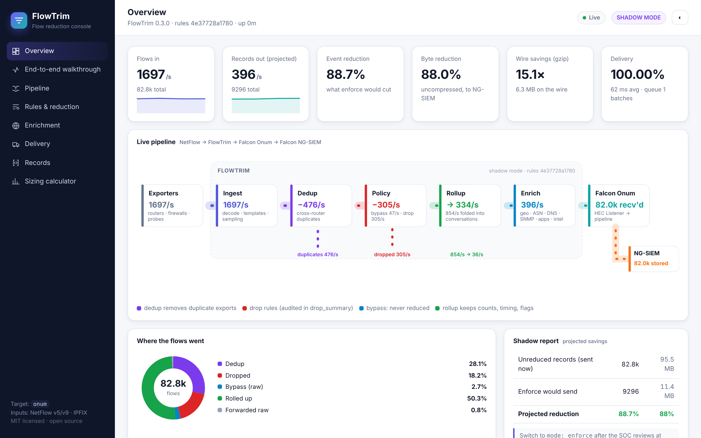
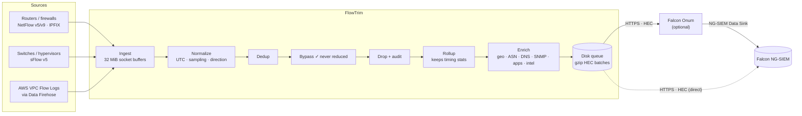
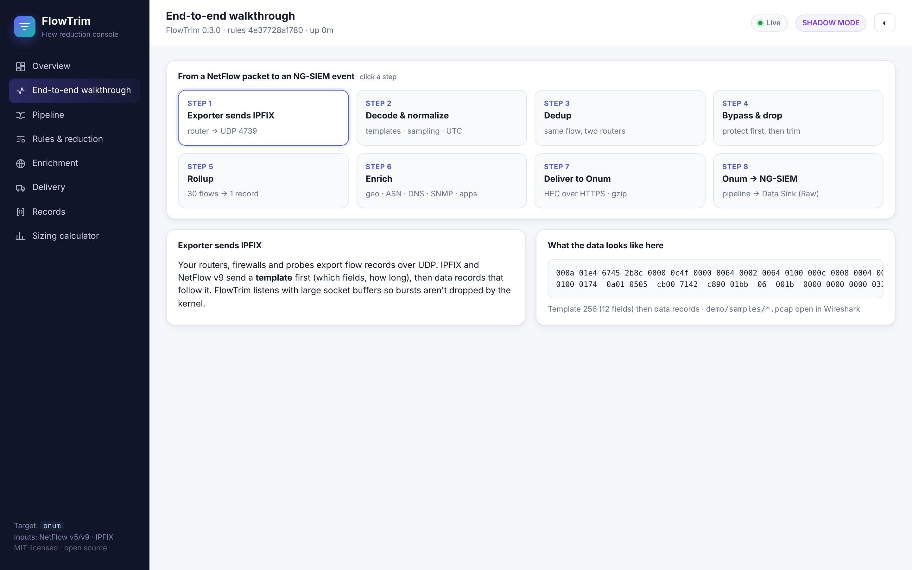
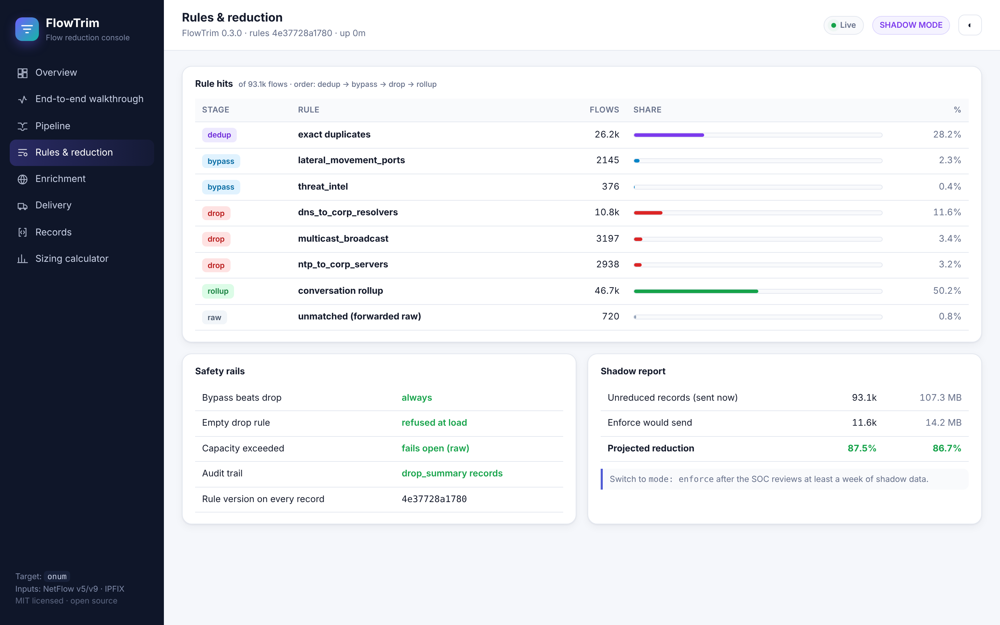
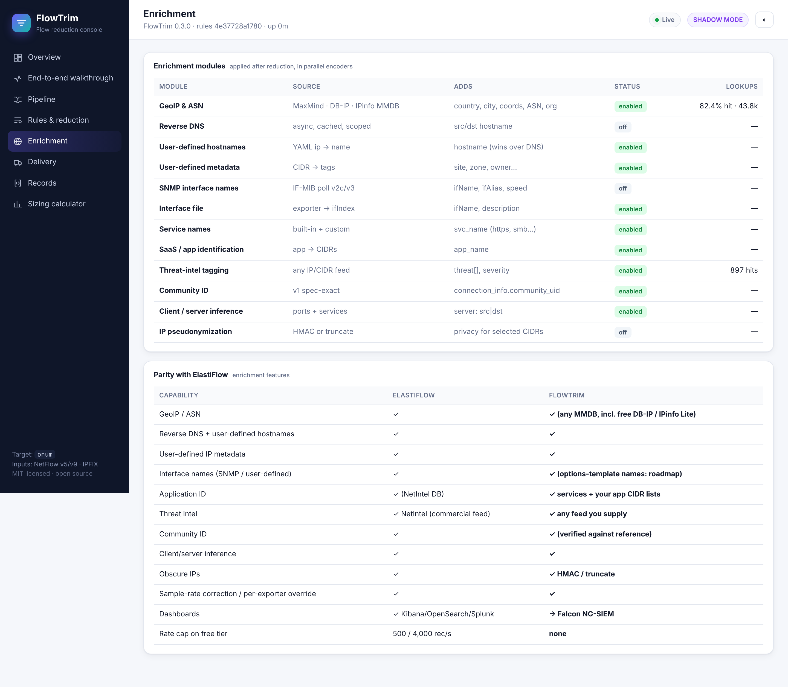
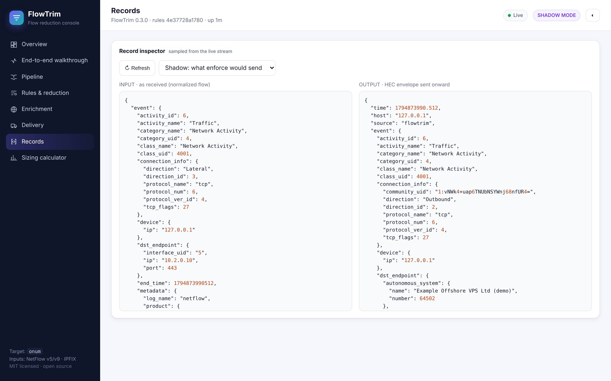
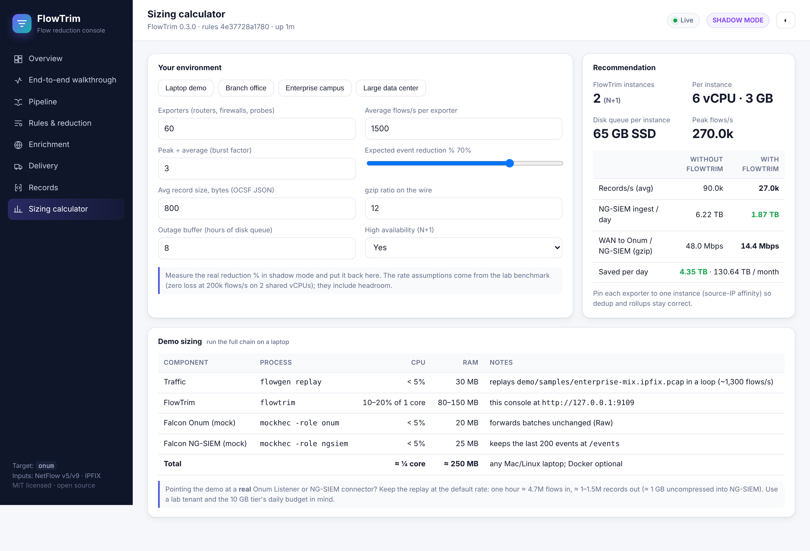

<div align="center">

# FlowTrim

**Collect every flow. Keep the signal. Ship a fraction.**

An open-source flow-log collector, reducer and enricher. It receives NetFlow, IPFIX, sFlow and AWS VPC Flow Logs, removes the volume that carries no security value, enriches what's left, and delivers it over HTTPS to **Falcon Onum** or directly to **Falcon Next-Gen SIEM**.

[](LICENSE)
[](go.mod)
[](CHANGELOG.md)
[](https://github.com/trip-nine/flowtrim/actions/workflows/ci.yml)



</div>

---

## Contents

- [Why FlowTrim](#why-flowtrim)
- [How it works](#how-it-works)
- [Quick start (2-minute demo)](#quick-start-2-minute-demo)
- [The console](#the-console)
- [Production in 7 steps](#production-in-7-steps)
- [Sizing](#sizing)
- [FlowTrim vs ElastiFlow](#flowtrim-vs-elastiflow)
- [Documentation](#documentation)
- [Versioning and releases](#versioning-and-releases)
- [License, trademarks, disclaimer](#license-trademarks-disclaimer)

---

## Why FlowTrim

Flow logs are some of the most useful network telemetry a SOC can have, and some of the most expensive to keep. Most of the volume is the same conversations repeated, the same flow exported by every router on the path, and housekeeping traffic nobody investigates.

| Problem | What FlowTrim does |
|---|---|
| Every router on the path exports the same flow | **Dedup** across exporters, with clock-skew tolerance |
| DNS/NTP to your own servers, multicast, health checks | **Drop** rules, with a `drop_summary` audit record for every rule |
| Chatty internal conversations (thousands of short flows) | **Rollup** into one record per window that keeps counts, totals, TCP flags and **connection timing** (so beaconing stays visible) |
| Scans hidden by aggregation | **Fanout summaries** per source (distinct destinations and ports) |
| Fear of dropping something important | **Bypass** rules (intel hits, denies, lateral-movement ports) are never reduced. **Shadow mode** measures savings before anything is dropped. |
| Flow IPs mean nothing to an analyst | **Enrichment**: GeoIP/ASN, hostnames, interface names (SNMP), services, SaaS apps, threat tags, Community ID |
| Onum Cloud has no NetFlow listener | FlowTrim is the **UDP → HTTPS bridge** |
| Free collectors cap you at 500–4,000 records/s | **No rate caps.** MIT licensed. Zero loss at 200k flows/s on 2 vCPUs in the lab. |

## How it works



**FlowTrim + Onum + NG-SIEM** together replace ElastiFlow. FlowTrim does the flow-aware work at the edge. Onum routes, masks and adds org-wide context. NG-SIEM stores, searches and detects. See [docs/01-overview.md](docs/01-overview.md) for layouts and the reasoning behind them.

## Quick start (2-minute demo)

This runs the whole chain on your laptop: sample IPFIX traffic → FlowTrim → mock Onum → mock NG-SIEM, with the live console. Copy the entire box, from the first line to the last:

```bash
bash <<'FLOWTRIM_DEMO'
set -euo pipefail
REPO="$HOME/src/flowtrim"
if [ -d "$REPO/.git" ]; then git -C "$REPO" pull --ff-only; else git clone https://github.com/trip-nine/flowtrim "$REPO"; fi
cd "$REPO"
./demo/run-demo.sh
FLOWTRIM_DEMO
```

Open **http://127.0.0.1:9109**. Press Ctrl-C to stop. It needs Go 1.24+. Alternatively, unpack a [release archive](https://github.com/trip-nine/flowtrim/releases) and run `./demo/run-demo.sh` from inside it, or use Docker: `docker compose -f deploy/docker/docker-compose.demo.yaml up --build`.

The sample captures in [`demo/samples/`](demo/README.md) open in Wireshark, and each comes with a ground-truth manifest.

## The console

The console is built into the binary and served at the telemetry port. If no FlowTrim is reachable (for example, when the page is opened as a file), it runs on a realistic simulation instead.

| Overview and live pipeline | End-to-end walkthrough |
|---|---|
|  |  |
| **Rules & reduction** | **Enrichment & ElastiFlow parity** |
|  |  |
| **Record inspector (input next to output)** | **Sizing calculator** |
|  |  |

## Production in 7 steps

| # | Step | Details |
|---|---|---|
| 1 | Size it | Use the console's **Sizing calculator** or [the table below](#sizing) |
| 2 | Install | Binary + systemd, or Docker ([02 Setup](docs/02-setup.md#22-install)) |
| 3 | Prepare the receiver | An **Onum HEC Listener** wired to an NG-SIEM Data Sink (event format **Raw**), or an **NG-SIEM HEC/HTTP Event Data Connector** |
| 4 | Configure | Copy a profile from `examples/profiles/`, put `HEC_URL` and `HEC_TOKEN` in the environment, run `flowtrim check` |
| 5 | Point exporters | IPFIX → UDP 4739, NetFlow → 2055, sFlow → 6343 ([exporter examples](docs/02-setup.md#25-point-exporters-at-flowtrim)) |
| 6 | Shadow week | Everything is forwarded unreduced. Read the projected savings in the console or at `/shadow`, and tune rules (`systemctl reload flowtrim`). |
| 7 | Enforce | After SOC sign-off, set `mode: enforce` and restart |

```yaml
# minimal production config (Layout A: FlowTrim → Onum → NG-SIEM)
mode: shadow
inputs:
  netflow: { listen: ["0.0.0.0:2055", "0.0.0.0:4739"], allowed_exporters: ["192.0.2.0/24"] }
rules:
  bypass: [ { name: denied, match: { action: [REJECT, DENY] } } ]
  drop:   [ { name: multicast, match: { dst_cidr: ["224.0.0.0/4", "ff00::/8"] } } ]
  dedup:  { enabled: true }
  rollup: { enabled: true, match: { direction: [internal, outbound] } }
  fanout: { enabled: true }
enrich:
  geoip: { city_db: /etc/flowtrim/dbip-city-lite.mmdb, asn_db: /etc/flowtrim/dbip-asn-lite.mmdb }
output:
  hec: { target: onum, url: "${HEC_URL}", token: "${HEC_TOKEN}", queue: { dir: /var/lib/flowtrim/queue } }
telemetry: { listen: "0.0.0.0:9109" }
```

## Sizing

| Peak flows/s (p99) | Instances | Per instance | Disk queue (8 h) |
|---|---|---|---|
| ≤ 20k | 1 | 2 vCPU · 2 GB | 20 GB |
| 20k–100k | 1 (+1 HA) | 4 vCPU · 4 GB | 50 GB |
| 100k–300k | 1–2 (+1 HA) | 6–8 vCPU · 4–8 GB | 100 GB |
| > 300k | ⌈peak ÷ 300k⌉ (+1 HA) | 8 vCPU · 8 GB | 100–200 GB |

The formulas and a worked example are in [docs/00-quickstart.md](docs/00-quickstart.md#right-sizing). The demo needs about ¼ of a core and 250 MB of RAM.

## FlowTrim vs ElastiFlow

| | ElastiFlow (Community / Basic) | FlowTrim |
|---|---|---|
| License | Proprietary EULA | **MIT** |
| Rate limit | 500 / 4,000 records/s, single instance | **None** |
| Configuration | Dozens of `EF_*` environment variables | **One YAML file**, strict validation, `flowtrim check` |
| Protocols | NetFlow, IPFIX, sFlow, cloud flow logs | NetFlow v5/v9, IPFIX, sFlow v5, AWS VPC (Firehose) |
| Enrichment | GeoIP, ASN, DNS, SNMP, app ID, NetIntel, metadata | GeoIP, ASN, DNS, SNMP, services and SaaS apps, any threat feed, metadata, Community ID, client/server, pseudonymization ([parity matrix](docs/05-enrichment.md#51-parity-matrix)) |
| Volume reduction before the SIEM | Storage-side (Elastic TSDS) | **Stream-side**: dedup, drop with audit, rollup with timing stats, fanout |
| Safety net | — | **Shadow mode** and projected savings |
| Destinations | Elastic, OpenSearch, Splunk, Kafka, … | **Falcon Onum**, **Falcon NG-SIEM**, any HEC receiver |
| Dashboards | Kibana / OpenSearch / Splunk | Built-in console, plus NG-SIEM for search and detections |

## Documentation

| Doc | For |
|---|---|
| [00 Quick start](docs/00-quickstart.md) | Demo, diagrams, right-sizing, demo sizing |
| [01 Overview](docs/01-overview.md) | What FlowTrim is, layouts with Onum and NG-SIEM, delivery guarantees |
| [02 Setup](docs/02-setup.md) | Install, receiver setup, exporter configs, verification, go-live |
| [03 User guide](docs/03-user-guide.md) | Modes, reading records, NG-SIEM searches, alerts, troubleshooting |
| [04 Configuration](docs/04-configuration.md) | Every key, type and default |
| [05 Enrichment](docs/05-enrichment.md) | Enrichment modules, ElastiFlow parity, free data sources |
| [Demo package](demo/README.md) | Sample captures, manifests, replaying into real receivers |
| [Rules playbook](docs/RULES.md) | Match syntax and tuning |
| [Plan and unknowns](docs/PLAN.md) | Roadmap, and the risks and unknowns register |
| [Benchmarks](docs/BENCHMARKS.md) | What was measured and how |

## Versioning and releases

- [Semantic Versioning](https://semver.org/). The current version is in [`VERSION`](VERSION), and changes are listed in [`CHANGELOG.md`](CHANGELOG.md).
- Tags `vX.Y.Z` trigger the [release workflow](.github/workflows/release.yml), which tests and builds archives for Linux (amd64/arm64), macOS (arm64/amd64) and Windows (amd64), with `SHA256SUMS`.
- `flowtrim version` prints the build version. Every record carries `rule_version`, a hash of the active rules.

```bash
bash <<'FLOWTRIM_BUILD'
set -euo pipefail
cd "$HOME/src/flowtrim"
make lint test build      # bin/flowtrim, bin/flowgen, bin/mockhec
make release              # dist/*.tar.gz + SHA256SUMS
FLOWTRIM_BUILD
```

## Project layout

```
cmd/flowtrim      the collector          internal/rules     reduction engine
cmd/flowgen       traffic gen + replay   internal/enrich    enrichment modules
cmd/mockhec       mock Onum / NG-SIEM    internal/output    HEC delivery + queue
demo/             one-command demo       internal/app/ui    the console (embedded)
deploy/           docker, systemd, sysctl, NG-SIEM parser, snmpsim data
examples/         reference config + deployment profiles
```

## Contributing

Pull requests are welcome. See [CONTRIBUTING.md](CONTRIBUTING.md). `make lint test` must pass. Reduction features need a test that proves which detection signal they preserve. Report vulnerabilities privately ([SECURITY.md](SECURITY.md)).

## License, trademarks, disclaimer

**MIT** © 2026 Trip Nine and the FlowTrim contributors. See [LICENSE](LICENSE) and the third-party notices in [NOTICE](NOTICE).

FlowTrim is an independent open-source project. "CrowdStrike", "Falcon", "Falcon Onum" and "Falcon Next-Gen SIEM" are trademarks of CrowdStrike, Inc. "ElastiFlow" is a trademark of ElastiFlow Inc. Those names are used only to describe interoperability and comparison. The project is not affiliated with or endorsed by either company. It ships no third-party GeoIP or threat-intelligence data. Validate any reduction policy in shadow mode before using it in production.
