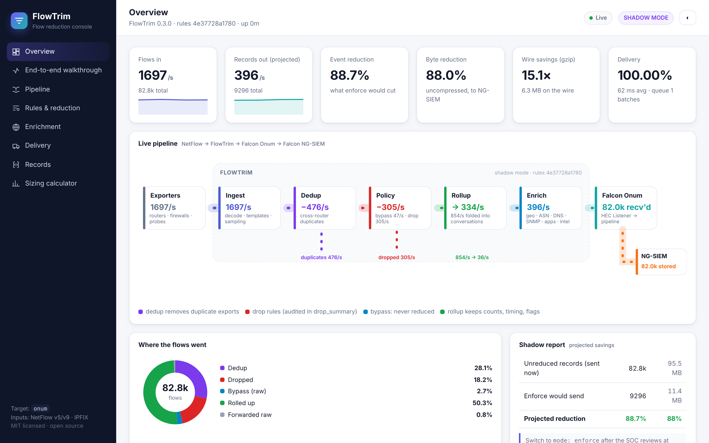
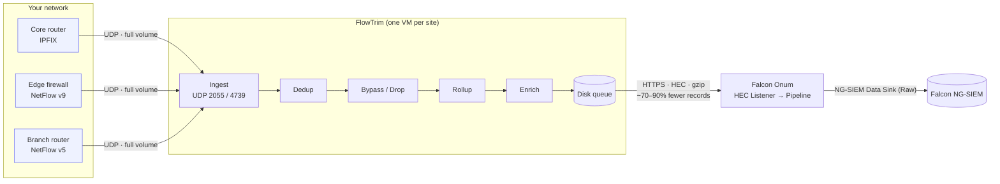
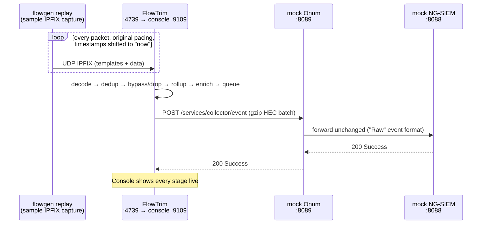
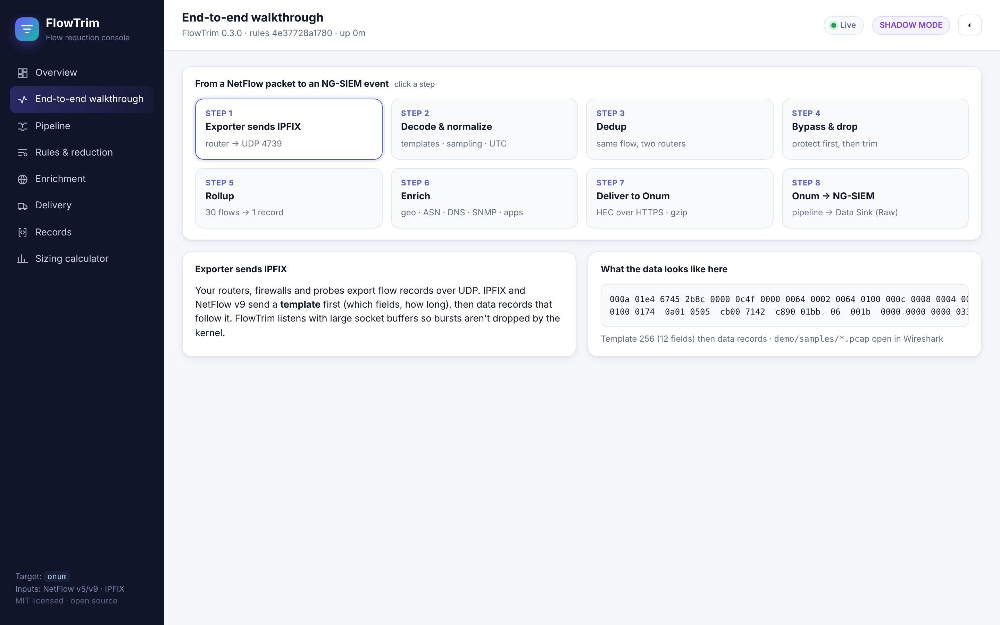
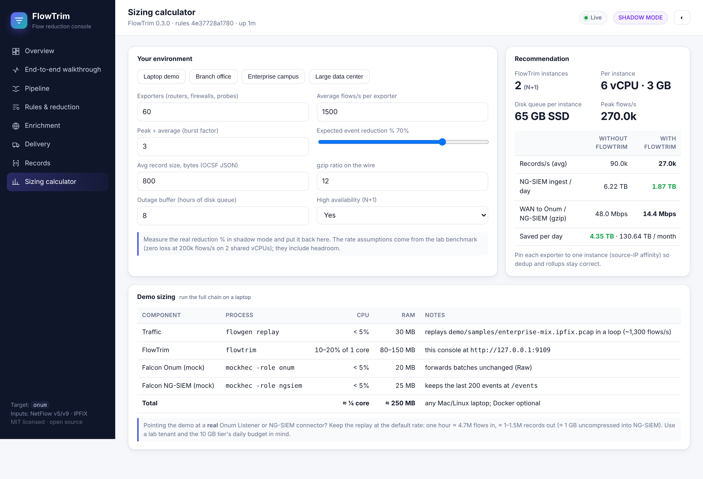
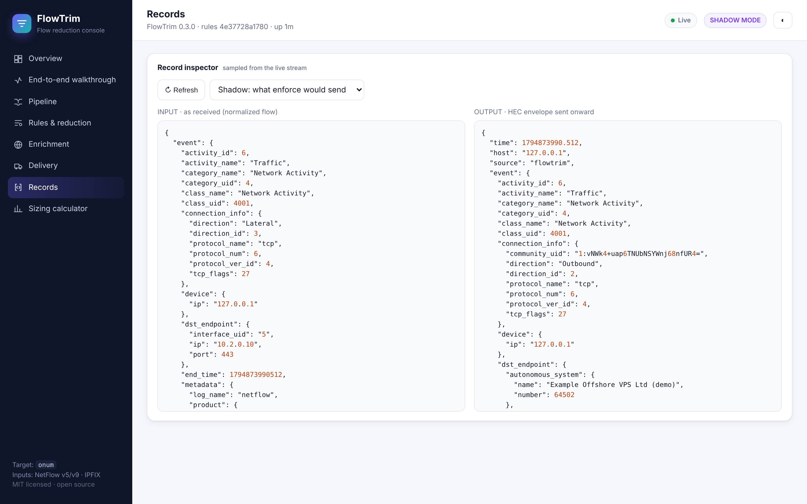
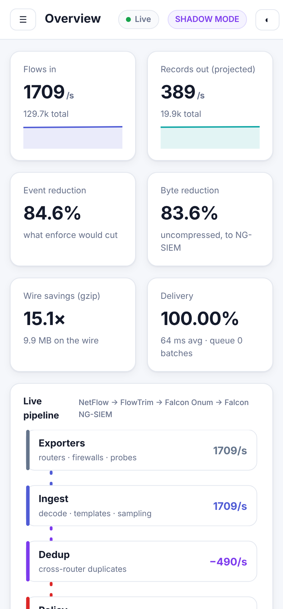
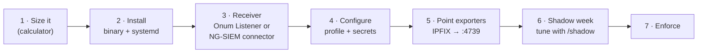

# 0. Quick Start

Three ways in, from fastest to production:

| Path | Time | You need | Result |
|---|---|---|---|
| **A. Laptop demo** | 2 min | Go 1.24+ (or a release binary) | The full chain on your machine: sample NetFlow → FlowTrim → mock Onum → mock NG-SIEM, with the live console |
| **B. Docker demo** | 3 min | Docker | The same chain in containers |
| **C. Real deployment** | 30 min | A Linux VM, routers, an Onum Listener or NG-SIEM connector | Production FlowTrim in shadow mode |



---

## The picture in one diagram



> **Analogy.** FlowTrim is the sorting room at the loading dock. Boxes arrive by the truckload (every flow from every router). It throws out the packing peanuts (duplicates, multicast, DNS to your own resolvers) and bundles the small parcels (rollups). Then it hands a much smaller, labelled shipment to the courier (Onum), which delivers it to the warehouse (NG-SIEM).

---

## A. Laptop demo (2 minutes)

Copy the whole box, from the first line to the last, into your home terminal. It clones the repo (or updates your existing clone), builds, and starts the demo:

```bash
bash <<'FLOWTRIM_DEMO'
set -euo pipefail
REPO="$HOME/src/flowtrim"
if [ -d "$REPO/.git" ]; then git -C "$REPO" pull --ff-only; else git clone https://github.com/trip-nine/flowtrim "$REPO"; fi
cd "$REPO"
./demo/run-demo.sh
FLOWTRIM_DEMO
```

Your browser opens **http://127.0.0.1:9109**. Press **Ctrl-C** in the terminal to stop everything.



**What to show in a demo:**

| Console page | Point it makes |
|---|---|
| **Overview** | Flows in vs records out, projected reduction, the live pipeline graphic with the Onum and NG-SIEM hops |
| **End-to-end walkthrough** | Eight steps from a raw IPFIX packet to an NG-SIEM event, with the data at each step |
| **Rules & reduction** | Which rule removed what, and the safety rails (bypass beats drop, fail-open) |
| **Enrichment** | GeoIP/ASN, hostnames, interface names, apps, threat tags, Community ID, and ElastiFlow parity |
| **Records** | Input flow next to the reduced, enriched record actually sent |
| **Sizing calculator** | Right-size the customer's environment live, in the meeting |

|  |  |
|---|---|
|  |  |

**Demo variations** (set these before running `./demo/run-demo.sh`):

| Variable | Example | Effect |
|---|---|---|
| `SAMPLE` | `demo/samples/campus.v9.pcap` | Use the NetFlow v9 or v5 sample instead of IPFIX |
| `SPEED` | `5` | Replay 5× faster |
| `REAL_HEC_URL` + `REAL_HEC_TOKEN` | Your lab Onum Listener or NG-SIEM connector | Skip the mocks and send to a real receiver |

---

## B. Docker demo

```bash
bash <<'FLOWTRIM_DOCKER_DEMO'
set -euo pipefail
REPO="$HOME/src/flowtrim"
if [ -d "$REPO/.git" ]; then git -C "$REPO" pull --ff-only; else git clone https://github.com/trip-nine/flowtrim "$REPO"; fi
docker compose -f "$REPO/deploy/docker/docker-compose.demo.yaml" up --build
FLOWTRIM_DOCKER_DEMO
```

Then open **http://127.0.0.1:9109**.

---

## C. Real deployment (summary)



The full walkthrough is in [02 Setup](02-setup.md). The profiles are in `examples/profiles/`.

---

## Right-sizing

### Rules of thumb

| Peak flows/s (p99) | FlowTrim instances | Per instance | Disk queue (8 h outage) | Typical site |
|---|---|---|---|---|
| ≤ 20k | 1 | 2 vCPU · 2 GB | 20 GB | Branch / lab |
| 20k–100k | 1 (+1 for HA) | 4 vCPU · 4 GB | 50 GB | Campus |
| 100k–300k | 1–2 (+1) | 6–8 vCPU · 4–8 GB | 100 GB | Large campus / small DC |
| > 300k | ⌈peak ÷ 300k⌉ (+1) | 8 vCPU · 8 GB | 100–200 GB | Data center |

### How the calculator works (and how to do it by hand)

| Quantity | Formula | Example (60 exporters × 1,500 flows/s, burst 3×, 70% reduction, 800 B/record, gzip 12×) |
|---|---|---|
| Average flows/s | exporters × flows/s per exporter | 90,000 |
| Peak flows/s | average × burst factor | 270,000 |
| Instances | ⌈peak ÷ 300,000⌉ (+1 for HA) | 1 + 1 = **2** |
| vCPU per instance | ⌈peak/100k + peak_out/40k + 0.5⌉, minimum 2 | **6** |
| RAM per instance | (0.4 GB + dedup state + rollup state + 256 MB queue) × 1.5 | **3 GB** |
| NG-SIEM GB/day before | average × 86,400 × record bytes | 6.2 TB |
| NG-SIEM GB/day after | before × (1 − reduction) | **1.9 TB** |
| WAN Mbps after | average × (1 − reduction) × bytes × 8 ÷ gzip | **14 Mbps** |
| Disk queue | out bytes/s ÷ gzip × outage hours × 3,600 × 1.25 | **65 GB** |

The throughput constants include headroom. The lab measured zero loss at 200k flows/s on 2 *shared* vCPUs, end to end. **Replace "70% reduction" with the number your shadow week measures.** That number varies more than anything else.

### Demo sizing

| Component | CPU | RAM | Notes |
|---|---|---|---|
| `flowgen replay` | < 5% | 30 MB | ~1,300 flows/s from the IPFIX sample |
| `flowtrim` + console | 10–20% of 1 core | 80–150 MB | |
| `mockhec -role onum` | < 5% | 20 MB | |
| `mockhec -role ngsiem` | < 5% | 25 MB | |
| **Total** | **≈ ¼ core** | **≈ 250 MB** | Any Mac or Linux laptop |

> Pointing the demo at a **real** NG-SIEM: one hour of the default replay is about 4.7M flows in and about 1–1.5M records out, roughly 1 GB uncompressed. Use a lab tenant and keep the tier's daily budget in mind.
