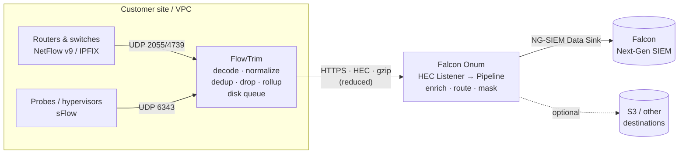
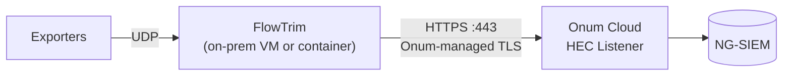
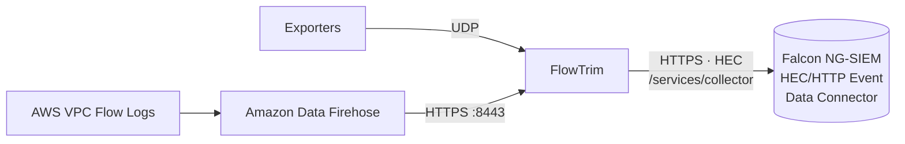
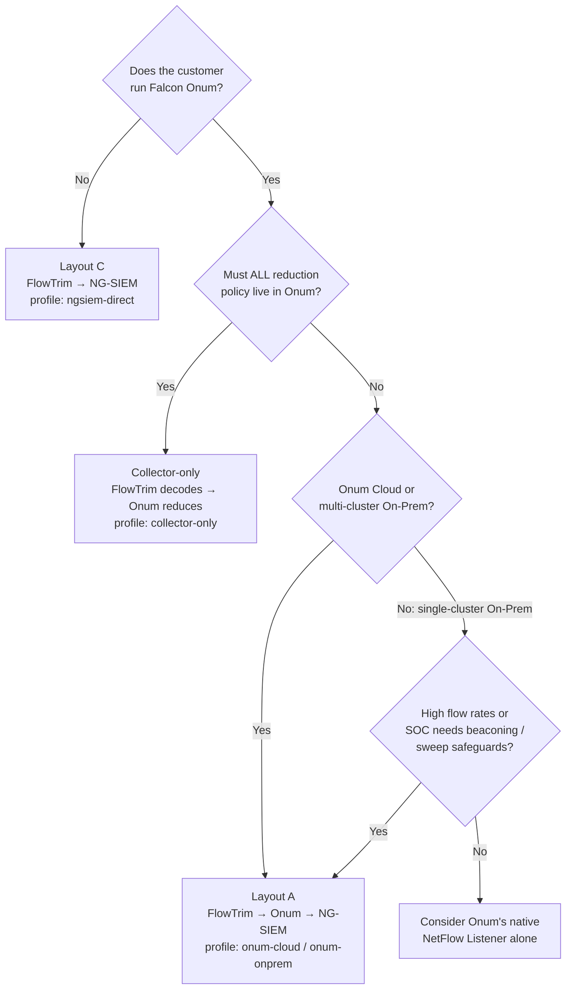
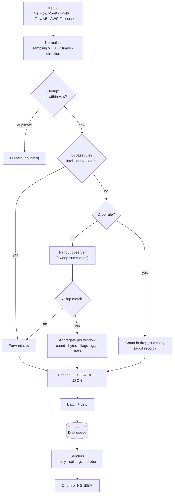
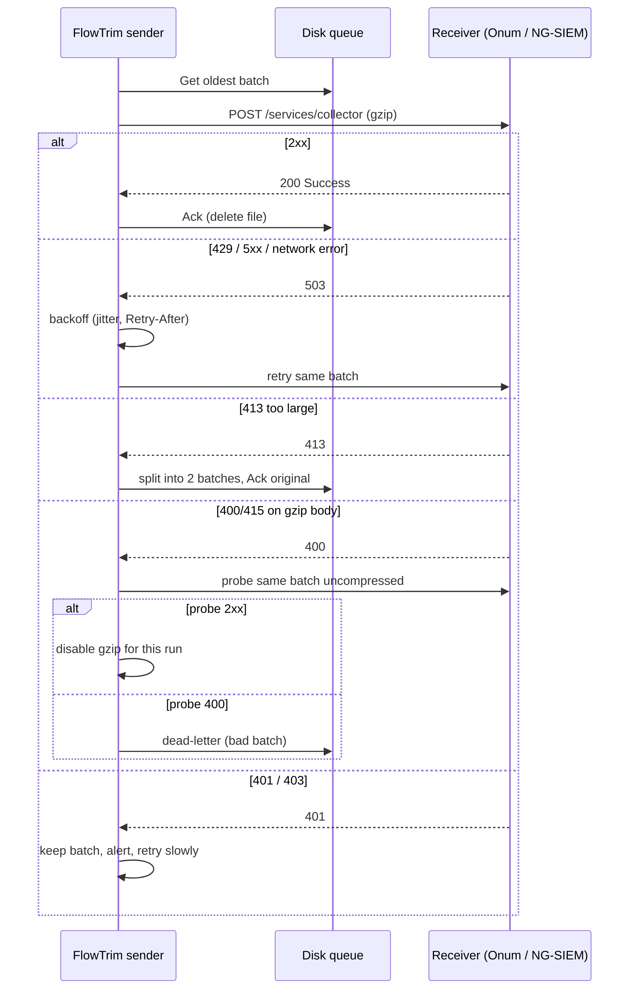

# 1. Overview: What FlowTrim Is (and Isn't)

## 1.1 One-sentence definition

**FlowTrim is a flow collector and flow-aware reducer.** It receives NetFlow, IPFIX, sFlow and AWS VPC Flow Logs, turns them into one clean format, removes the volume that carries no security value, and delivers the rest reliably over HTTPS. The destination is either Falcon Onum or Falcon Next-Gen SIEM.

> **Analogy.** FlowTrim is the sorting room at the loading dock. It opens the boxes, throws out the packing peanuts, and bundles the small parcels. Onum is the courier network that decides where everything goes. NG-SIEM is the warehouse where it's stored and searched.

## 1.2 Is FlowTrim a full replacement for ElastiFlow?

**No, and it isn't meant to be on its own.** ElastiFlow is a whole product: a collector, enrichment, storage integrations, and dashboards. In a CrowdStrike stack, those jobs split across three components. **FlowTrim + Onum + NG-SIEM together replace ElastiFlow**:

| ElastiFlow capability | Who does it in this stack | Status |
|---|---|---|
| Receive NetFlow v5/v9, IPFIX, sFlow over UDP | **FlowTrim** | ✅ Built |
| Receive AWS VPC Flow Logs (Firehose HTTPS) | **FlowTrim** | ✅ Built |
| Decode templates, apply sampling rate | **FlowTrim** (goflow2 library) | ✅ Built |
| Normalize to one schema | **FlowTrim** (OCSF Network Activity 4001 shape) | ✅ Built |
| Reduce volume (dedup, drop, rollup) | **FlowTrim**. ElastiFlow only shrinks *storage* inside Elastic; it doesn't reduce what crosses the wire. | ✅ Built |
| GeoIP / ASN enrichment | **Onum** (Lookup actions) or **NG-SIEM** at query time (`ipLocation()`, `asn()`) | Not in FlowTrim v0.1 (roadmap v0.4) |
| Reverse DNS, SNMP interface names | **Onum** lookups, or FlowTrim later | Not built (roadmap v0.4) |
| Threat-intel tagging | **NG-SIEM** (Falcon intel) / **Onum**. FlowTrim uses intel lists only to *protect* flows from reduction. | Partial (bypass lists) |
| Routing to other destinations (S3, Kafka, other SIEMs) | **Onum** | n/a in FlowTrim by design |
| Storage, search, dashboards, detections | **NG-SIEM** | n/a in FlowTrim by design |
| Licensing per records/second | Nobody. FlowTrim is Apache-2.0 with no rate caps. | ✅ |

## 1.3 Is the main job enrichment or reduction?

**Reduction and normalization.** Enrichment is deliberately *not* FlowTrim's main job.

| Job | FlowTrim | Onum | NG-SIEM |
|---|---|---|---|
| **Getting flows off the wire without loss** (UDP sockets, buffers, templates) | **Owner** | Only on-prem, one cluster, UDP only | — |
| **Putting them in the right format** (OCSF shape, UTC times, scaled counters, direction) | **Owner** | Can re-map | Parser maps to CPS fields |
| **Flow-aware reduction** (cross-router dedup, rollups that keep beaconing stats, sweep summaries, drop audit trail) | **Owner** | Generic filter/group/sample actions | — |
| **Generic reduction** (dropping fields, sampling for a *secondary* destination) | Optional | **Owner** | — |
| **Enrichment** (Geo, ASN, CMDB, identity) | — | **Owner** | Query-time functions |
| **Routing, masking, multi-destination** | — | **Owner** | — |
| **Detection, search, retention** | — | — | **Owner** |

**Why the flow-aware reduction stays in FlowTrim.** Collapsing flows safely needs *state*. You have to remember a conversation for 60 seconds, notice the same flow arriving from two routers 400 ms apart, and measure the gaps between connections to keep beaconing visible. That logic depends on what a flow *means*. Doing it next to the routers also stops the bulk from ever crossing the network. Onum is described as a stateless, in-memory pipeline. Its generic Group By and Unique actions can filter and group events, but they don't know flow semantics.

**If the customer wants every policy in Onum,** run FlowTrim with the `collector-only` profile: decode and normalize only, no reduction. It works, but you lose the flow-specific safeguards, and the full volume crosses the network. See [§1.5](#15-choosing-a-layout).

## 1.4 Deployment layouts

### Layout A, with Onum (recommended when the customer runs Onum)

### Layout A with Onum Cloud

Onum's NetFlow Listener isn't offered in Cloud tenants, so FlowTrim acts as the bridge from UDP to HTTPS:

### Layout C, direct to NG-SIEM (no Onum; proofs of concept, smaller customers)

### Not recommended: Onum first, FlowTrim after

Here Onum would carry the full volume and then hand it back out to FlowTrim. That inherits every limit of Onum's NetFlow Listener (UDP only, no Cloud, one cluster), and the heaviest data takes the most hops. **Reduce where the volume is created.**

## 1.5 Choosing a layout

| Profile file | Layout | Reduction runs in |
|---|---|---|
| `examples/profiles/onum-onprem.yaml` | A | FlowTrim (+ optional Onum) |
| `examples/profiles/onum-cloud.yaml` | A (Cloud) | FlowTrim (+ optional Onum) |
| `examples/profiles/ngsiem-direct.yaml` | C | FlowTrim |
| `examples/profiles/collector-only.yaml` | A, without FlowTrim reduction | Onum |

## 1.6 Inside FlowTrim

## 1.7 Delivery guarantees

Delivery is **at-least-once**. A batch is deleted only after a 2xx response. If a request times out *after* the receiver accepted it, the retry can produce a duplicate batch. That's rare, and the batch arrives whole.
