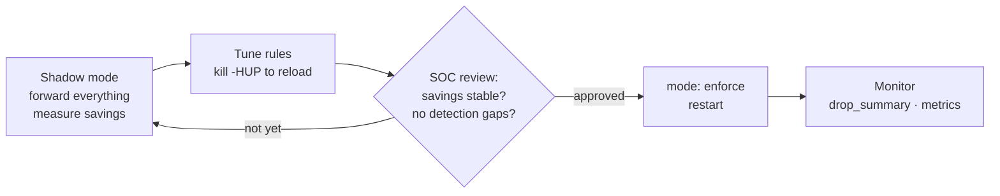

# 2. Setup Guide

Follow the sections in order. Each step ends with a **✔ check** so you know it worked before moving on.

| Step | You'll do | Time |
|---|---|---|
| 2.1 | Size and place the collector | 10 min |
| 2.2 | Install FlowTrim | 10 min |
| 2.3 | Prepare the receiver (NG-SIEM connector **or** Onum Listener) | 15 min |
| 2.4 | Configure FlowTrim | 15 min |
| 2.5 | Point exporters at FlowTrim | 15 min per device type |
| 2.6 | (Optional) AWS VPC Flow Logs via Firehose | 20 min |
| 2.7 | Verify end to end | 10 min |
| 2.8 | Shadow week, then go live | 1–2 weeks |

---

## 2.1 Size and place the collector

| Peak flows/s (p99, not average) | vCPU | RAM | Disk queue | Notes |
|---|---|---|---|---|
| ≤ 50k | 2 | 2 GB | 20 GB SSD | Lab-measured ceiling on 2 shared vCPUs: 200k/s with zero loss |
| 50k–200k | 4 | 4 GB | 50 GB SSD | Set `sockets: 4`, `workers: 8` |
| > 200k | 8+ | 8 GB | 100 GB SSD | Or run several instances (see below) |

**Placement rules**

1. Put FlowTrim **at the same site as the exporters** (the routers and switches sending flows). Flows travel over UDP, which has no retransmission, so keep that hop short.
2. In Layout A, run it **next to the Onum Distributor**.
3. **One exporter → one FlowTrim instance.** Dedup and rollup state live inside each instance. If you run several, split exporters across them by source IP, and never spread one router across instances.
4. The disk queue must be on **local persistent storage**, not tmpfs.

**Ports**

| Port | Direction | Purpose |
|---|---|---|
| UDP 2055, 4739 | exporters → FlowTrim | NetFlow v5/v9, IPFIX |
| UDP 6343 | exporters → FlowTrim | sFlow |
| TCP 8443 | AWS Firehose → FlowTrim | VPC Flow Logs (optional) |
| TCP 443 / Listener port | FlowTrim → Onum or NG-SIEM | HTTPS output |
| TCP 9109 | monitoring → FlowTrim | `/metrics`, `/healthz`, `/shadow` |

---

## 2.2 Install

### Option 1: Linux binary + systemd (recommended for VMs)

Copy the whole box, from the first line to the last, into a terminal on the collector host:

```bash
bash <<'FLOWTRIM_INSTALL'
set -euo pipefail
REPO="$HOME/src/flowtrim"                      # where the FlowTrim source lives
cd "$REPO"
CGO_ENABLED=0 go build -trimpath -ldflags "-s -w" -o bin/flowtrim ./cmd/flowtrim
sudo install -m 0755 bin/flowtrim /usr/local/bin/flowtrim
sudo useradd --system --no-create-home --shell /usr/sbin/nologin flowtrim 2>/dev/null || true
sudo install -d -m 0750 -o flowtrim -g flowtrim /var/lib/flowtrim
sudo install -d -m 0755 /etc/flowtrim
sudo install -m 0644 "$REPO/examples/flowtrim.yaml" /etc/flowtrim/flowtrim.yaml
sudo install -m 0644 "$REPO/examples/intel.txt" /etc/flowtrim/intel.txt
sudo install -m 0644 "$REPO/deploy/systemd/flowtrim.service" /etc/systemd/system/flowtrim.service
sudo install -m 0644 "$REPO/deploy/sysctl/99-flowtrim.conf" /etc/sysctl.d/99-flowtrim.conf
sudo sysctl --system >/dev/null
[ -f /etc/flowtrim/flowtrim.env ] || printf 'HEC_URL=\nHEC_TOKEN=\n' | sudo tee /etc/flowtrim/flowtrim.env >/dev/null
sudo chmod 600 /etc/flowtrim/flowtrim.env
sudo systemctl daemon-reload
echo "Installed. Next: fill /etc/flowtrim/flowtrim.env and edit /etc/flowtrim/flowtrim.yaml (section 2.4)."
FLOWTRIM_INSTALL
```

**✔ check:** `flowtrim version` prints a version.

### Option 2: Docker

```bash
bash <<'FLOWTRIM_DOCKER'
set -euo pipefail
REPO="$HOME/src/flowtrim"
cd "$REPO"
docker build -f deploy/docker/Dockerfile -t flowtrim:local "$REPO"
docker run -d --name flowtrim --restart unless-stopped \
  -p 2055:2055/udp -p 4739:4739/udp -p 9109:9109 \
  --sysctl net.core.rmem_max=33554432 \
  -e HEC_URL -e HEC_TOKEN \
  -v "$REPO/examples/flowtrim.yaml:/etc/flowtrim/flowtrim.yaml:ro" \
  -v flowtrim-queue:/var/lib/flowtrim \
  flowtrim:local
FLOWTRIM_DOCKER
```

> On Docker, set `telemetry.listen: "0.0.0.0:9109"` in the config so the port mapping can reach it.

### Option 3: Kubernetes

Not yet packaged (Helm chart is on the v0.2 roadmap). If you deploy by hand, use a **StatefulSet** with a PVC for `/var/lib/flowtrim`, a UDP `Service` with `externalTrafficPolicy: Local` (this preserves exporter source IPs), and `sessionAffinity: ClientIP`.

### Local demo (no tenant, no routers)

See the Quick start in the [README](../README.md): mock receiver, synthetic traffic, and a shadow report in about 30 seconds.

---

## 2.3 Prepare the receiver

### Path C: Falcon Next-Gen SIEM directly

1. In the Falcon console, go to **Next-Gen SIEM → Data onboarding** and click **Add data connector**.
2. Choose **HEC / HTTP Event Data Connector** and click **Configure**.
3. Name it (for example `flowtrim-<site>`). For the parser, use the starter parser in `deploy/ngsiem/flowtrim-parser.logscale`: create it first under *Log management → Parsers*, then select it here.
4. Save. When the banner says the connector is ready, open its menu and click **Generate API key**.
5. Copy the **API key** (it's shown only once) and the **API URL**.

**✔ check:** the connector shows as *Active / waiting for data*.

### Path A: Falcon Onum (On-Prem or Cloud)

> ⚠ **Lab-verify these settings.** Onum's public docs don't fully specify the HEC Listener's auth header, path, gzip support or size limits (see the [Plan](PLAN.md), unknowns O1–O4). FlowTrim's `target: onum` preset assumes Splunk-HEC conventions: `Authorization: Splunk <token>` on `/services/collector/event`. Override `auth_scheme` and `path` if your Listener differs.

1. **Data Sink first.** In Onum, create a **Falcon NG-SIEM Data Sink** using the API URL and key from an NG-SIEM HEC connector (steps 1–5 above).
2. **Listener.** Create a **Splunk HEC** Listener (or the HTTP Listener, if your Onum version recommends it), and set a token. Note its **Address**: in Cloud it's port 443 with Onum-managed TLS; On-Prem it's the Distributor host and port.
3. **Pipeline.** Wire the Listener to the NG-SIEM Data Sink. Keep the event body **unchanged**: no Message Builder that re-wraps it, so NG-SIEM receives FlowTrim's JSON as is. Optionally add Lookup actions for Geo/ASN enrichment.
4. **On-Prem TLS.** If the Distributor uses your own CA, export the CA certificate for FlowTrim (`tls.ca_file`).

**✔ check:** the Onum Listener shows as healthy, and the pipeline is deployed to the right cluster.

---

## 2.4 Configure FlowTrim

1. Start from the profile that matches your layout ([Overview §1.5](01-overview.md#15-choosing-a-layout)):

   | Layout | Copy this file to `/etc/flowtrim/flowtrim.yaml` |
   |---|---|
   | A, Onum On-Prem | `examples/profiles/onum-onprem.yaml` |
   | A, Onum Cloud | `examples/profiles/onum-cloud.yaml` |
   | C, NG-SIEM direct | `examples/profiles/ngsiem-direct.yaml` |
   | Onum does all reduction | `examples/profiles/collector-only.yaml` |

2. Put secrets in `/etc/flowtrim/flowtrim.env`, **never in the YAML**:

   ```ini
   HEC_URL=https://<id>.ingest.us-1.crowdstrike.com
   HEC_TOKEN=<api key or Onum Listener token>
   ```

3. Edit the YAML:
   - `networks.internal`: **your** address space. This drives direction, and direction drives rollup and lateral-movement bypass.
   - `inputs.netflow.allowed_exporters`: your routers' IPs. Everything else is rejected.
   - `rules.drop`: replace the example IPs `10.0.0.53` and `10.0.0.123` with *your* DNS and NTP servers, or delete those rules.
   - Leave `mode: shadow`.

4. Validate:

   ```bash
   bash <<'FLOWTRIM_CHECK'
   set -euo pipefail
   set -a; . /etc/flowtrim/flowtrim.env; set +a
   /usr/local/bin/flowtrim check -config /etc/flowtrim/flowtrim.yaml
   FLOWTRIM_CHECK
   ```

   **✔ check:** you see `config OK`, and `output hec` shows the right target, URL and auth scheme.

5. Start it: `sudo systemctl enable --now flowtrim`

---

## 2.5 Point exporters at FlowTrim

Use **IPFIX or NetFlow v9** where you can. They carry more fields than v5 (IPv6, TCP flags on more platforms). Use 60 s active and 15 s inactive timeouts. Replace `10.0.0.50` with the FlowTrim host.

### Cisco IOS-XE (Flexible NetFlow)

```
flow record FT-REC
 match ipv4 source address
 match ipv4 destination address
 match ipv4 protocol
 match transport source-port
 match transport destination-port
 match interface input
 collect interface output
 collect transport tcp flags
 collect counter bytes long
 collect counter packets long
 collect timestamp absolute first
 collect timestamp absolute last
!
flow exporter FT-EXP
 destination 10.0.0.50
 source Loopback0
 transport udp 4739
 export-protocol ipfix
 template data timeout 60
!
flow monitor FT-MON
 exporter FT-EXP
 record FT-REC
 cache timeout active 60
 cache timeout inactive 15
!
interface GigabitEthernet1
 ip flow monitor FT-MON input
```

> Export on **one direction per interface** (input) on every device. Exporting both input and output on the same device produces two records for each flow. Those aren't duplicates under the default dedup key, so they double the volume.

### Palo Alto Networks (PAN-OS)

*Device → Server Profiles → NetFlow*: add a server at `10.0.0.50`, port `2055`, template refresh 60 s. Then under *Network → Interfaces → (interface) → Advanced*, set the NetFlow profile.

### Juniper, Arista, Fortinet, others

Any exporter that sends NetFlow v5/v9, IPFIX or sFlow v5 over UDP works. Point it at the FlowTrim host, on port 4739 for IPFIX, 2055 for NetFlow, or 6343 for sFlow.

**✔ check:** `curl -s localhost:9109/metrics | grep flowtrim_flows_received_total` keeps increasing.

---

## 2.6 (Optional) AWS VPC Flow Logs via Amazon Data Firehose

1. Give FlowTrim a **publicly trusted TLS certificate**. Firehose HTTP endpoints must be HTTPS. Set `inputs.aws_firehose.tls_cert` and `tls_key`, or terminate TLS on a load balancer in front of FlowTrim.
2. Set a long random `access_key` (`${FIREHOSE_ACCESS_KEY}`).
3. In AWS, create a **Firehose stream**: source *Direct PUT*, destination *HTTP Endpoint*, URL `https://flowtrim.example.com:8443/`, access key as above, content encoding *GZIP*.
4. Create the **VPC Flow Log** with destination *Amazon Data Firehose*. If you pick a custom format, copy the exact field order into `inputs.aws_firehose.fields`.
5. Add a drop rule for `log_status: [NODATA, SKIPDATA]`. AWS logs are already aggregated (1 or 10 minutes), so consider `rollup.match: { source: [netflow, sflow] }`.

**✔ check:** `flowtrim_flows_received_total{input="aws_firehose"}` increases, and the Firehose console shows successful deliveries.

---

## 2.7 Verify end to end

| # | Check | Command / place | Expected |
|---|---|---|---|
| 1 | Service up | `systemctl status flowtrim` | `active (running)` |
| 2 | Big socket buffer | `journalctl -u flowtrim \| grep "UDP receive buffer"` | `bytes: 33554432`, with no "smaller than requested" warning |
| 3 | Flows arriving | `/metrics` → `flowtrim_flows_received_total` | Increasing |
| 4 | Nothing rejected | `flowtrim_flows_rejected_total` | Flat (a few `template_not_found` right after start is normal) |
| 5 | Delivered | `flowtrim_output_http_status_total{code="200"}` | Increasing |
| 6 | Queue drained | `flowtrim_queue_batches` | Near 0 |
| 7 | Visible in the SIEM | NG-SIEM *Advanced event search*: `#Vendor="flowtrim"` | Events arriving |
| 8 | Kernel drops | `grep Udp: /proc/net/snmp` (column `RcvbufErrors`) | Not increasing |

---

## 2.8 Shadow week, then go live



1. Run in shadow mode for **at least 7 days**, so you cover weekly cycles such as backups and patching.
2. Read `curl -s localhost:9109/shadow` daily, or search `record_type="shadow_report"` in NG-SIEM.
3. Tune with the [Rules playbook](RULES.md), then reload with `sudo systemctl reload flowtrim`.
4. Get SOC sign-off, set `mode: enforce`, and run `sudo systemctl restart flowtrim`.
